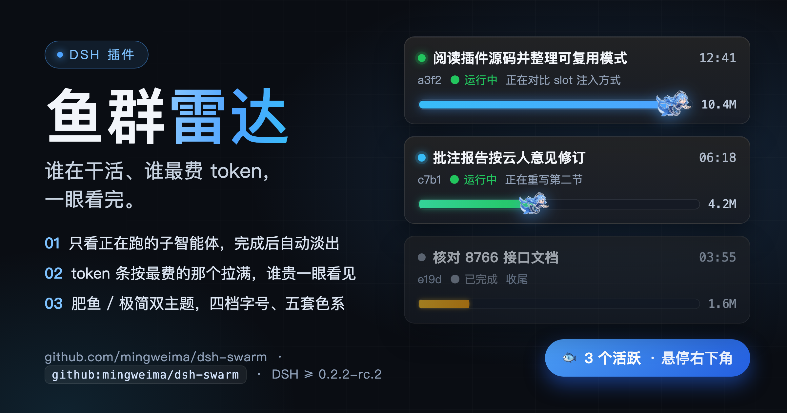

# 鱼群雷达 · 推介文案



仓库：<https://github.com/mingweima/dsh-swarm>

---

## 一句话

DSH 右下角一条「鱼群 N 活跃」，谁在干活、谁最费 token，一眼看完。

---

## 短版（Slack / 群聊，直接粘）

```
@sr 给你做了个 DSH 插件「鱼群雷达」，已开源：
https://github.com/mingweima/dsh-swarm

一句话：右下角一条「鱼群 N 活跃」，点开就能看到每个子智能体在干什么、跑了多久、
烧了多少 token。token 条按本屏最费的那个拉满——谁最贵一眼看见，条末端还有只
蓝毛小女仆大肥鱼拉着条往前游。

只看活着的：正在跑的 + 刚完成 60 秒内的，干完自动淡出，眼睛不被死卡片占着。
肥鱼 / 极简双主题，四档字号、五套色系，设置存本机，20 个 agent 一起跑也不炸。

装法：Plugins → Add plugin → 填 github:mingweima/dsh-swarm
命令行：dsh plugin --profile desktop add github:mingweima/dsh-swarm
要求 DSH >= 0.2.2-rc.2。
```

---

## 长版（介绍文 / 邮件 / 文档）

**开了 16 路子智能体之后，你其实不知道它们在干什么。**

DSH 的子代理一开就是一片，进度在哪儿、卡住没有、哪一个在烧 token，全靠翻会话。等你想起来看一眼，已经过去十分钟。

**鱼群雷达**把这件事压到一条悬浮条上。它挂在界面右下角，不占侧栏、不抢版面：

- **只显示活着的**——正在跑的子智能体，加上刚完成 60 秒内的（灰掉淡出）。干完的自动消失，屏幕永远只反映当下。
- **一条条 token 进度条**——以本屏消耗最多的那个为满格基准，谁最长的就是最费的。不用算，扫一眼就知道钱花在哪。
- **它在干什么也写着**——卡片上直接给任务名、跑了多久、当前动作（比如「正在读取接口文档」），不用点进去。
- **点一下就进去**——想细看某一只？点它的卡片直接跳到那个子 agent 的会话，弹层自动收起。
- **看着爽**——进度条末端挂一只蓝毛小女仆大肥鱼，跟着进度往前拉。做正事的时候，这是唯一一个不刺眼的进度显示。

不想要形象？切「极简」主题，纯进度条 + 圆点，一秒变工具。

**它只读。** 不写文件、不联网、不碰凭据，数据全部来自当前会话自己的投影（subagentCatalog / tokenUsage / subagentTiming）。

---

## 30 秒口播（开会用）

> 子代理一多，最大的问题是「不知道它在干嘛」。鱼群雷达就在右下角一条：几个在跑、每个干什么、谁最费 token，全在上面。干完的自动消失。装一行命令，开源在 GitHub，MIT。

---

## English one-liner

A DSH plugin that shows live subagents at a glance: what each one is doing, how long it has run, and a token bar scaled to the heaviest consumer — with the fish swimming the bar forward.

---

## 安装

```bash
# 图形界面：Plugins → Add plugin → github:mingweima/dsh-swarm
dsh plugin --profile desktop add github:mingweima/dsh-swarm
```

要求 DSH `>=0.2.2-rc.2 <0.3.0`。
